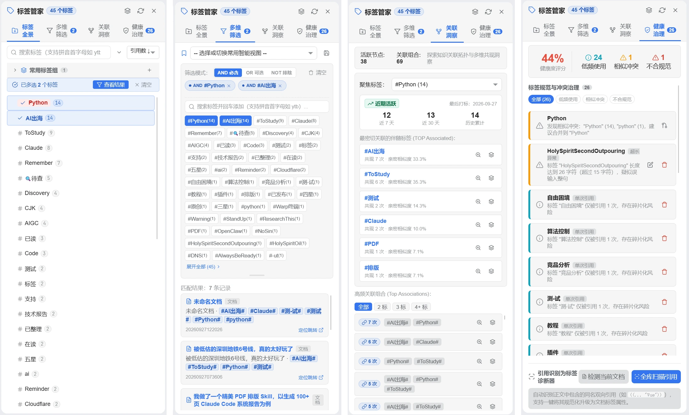
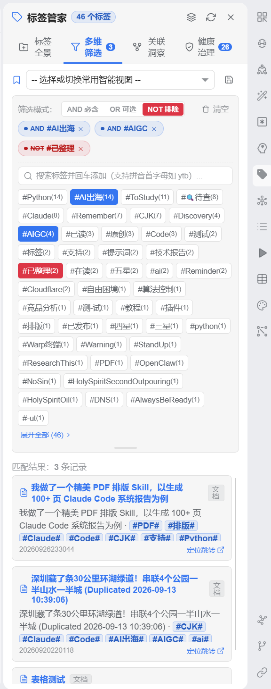
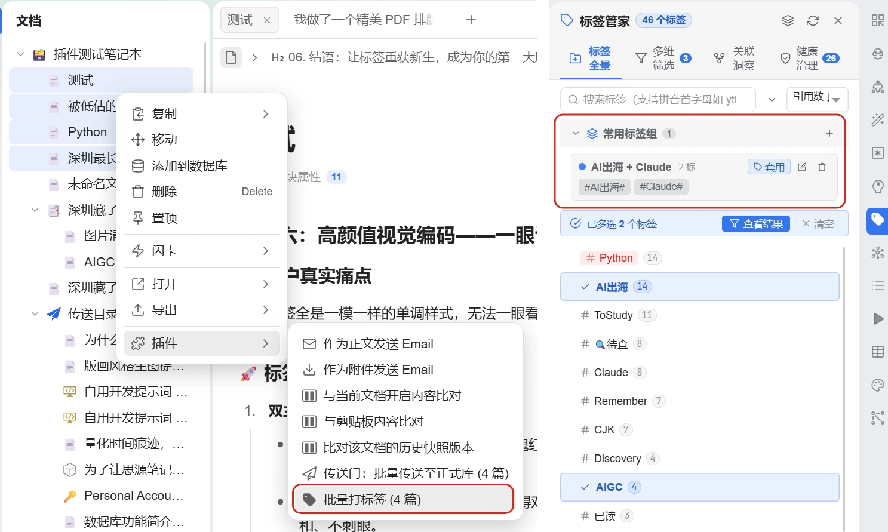
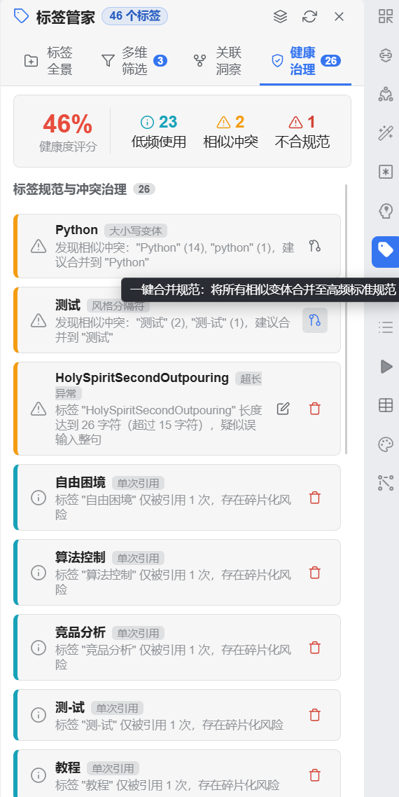
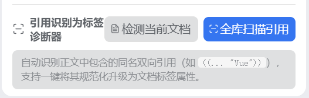
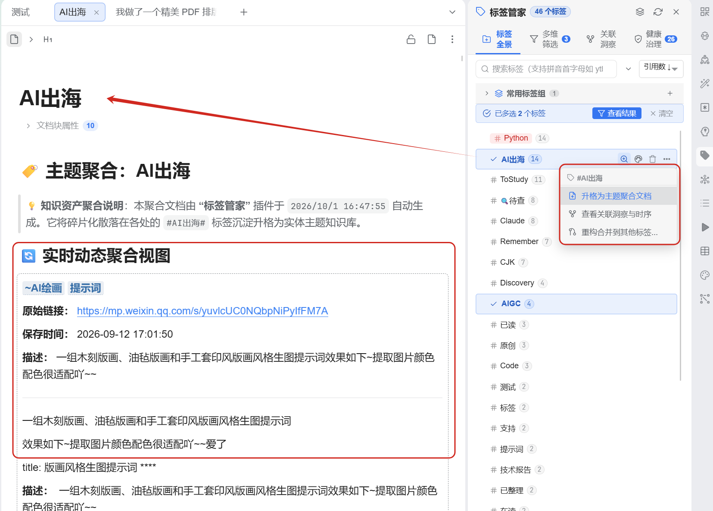
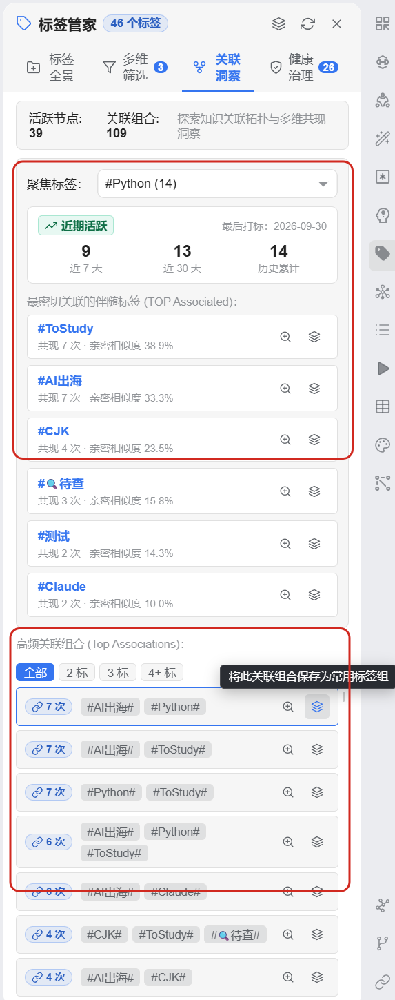
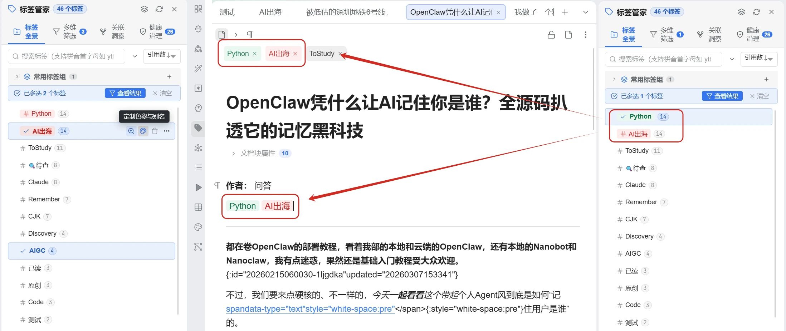

# 为什么“标签”在思源笔记中的存在感这么弱？——“标签管家”能否挽救这个局面？

思源笔记插件开发实践 [*](https://ld246.com/article/1790845505503)

> 汇聚标签资产，理顺知识脉络。

## 楔子：被冷落的标签

在现代个人知识管理系统中进行笔记管理时，“标签”通常是与“文件夹”、“双向链接”并驾齐驱的三大手段之一。然而在思源笔记中，我们却常常有这样的感受：

- “一开始热情满满打了很多 ​`#标签#`，两三个月后发现标签列表里几百个词，乱成一锅粥，根本不想看。”
- “在标签面板点击一个标签就弹出一个巨大的搜索框，把阅读空间遮住了一大半，想靠标签找到笔记太困难，体验太割裂。”
- “思源用双链就好了，什么都能用 ​`((块引用))` 搞定，标签根本没有存在的必要。”

久而久之，“标签”在很多思源用户的知识库里沦为了鸡肋——建之无用，弃之可惜，存在感越来越弱。

## 为什么“标签”在思源笔记中的存在感这么弱？

如果仔细审视日常笔记流与思源笔记提供的标签功能，当前标签存在感弱的原因可以归纳为三重困境：

### 困境一：标签天然的“无约束性”与“语义漂移”

标签之所以被广泛使用，是因为它极其轻量：随手输入 ​`#` 就能打上。然而，这种“极度的自由”如果没有系统性治理，必然会迅速演变为灾难性的“标签债务”：

1. **大小写割裂**：同一概念因为输入习惯不同，分裂为 ​`Prompt`​ 与 ​`prompt`​、​`Python`​ 与 ​`python`；
2. **符号与同义词变体**：​`web-dev`​ 与 ​`web_dev`​、​`复盘`​ 与 ​`回顾`​、​`TODO`​ 与 ​`待办` 各自为政；
3. **单次标签通胀**：大量一时兴起打上的标签，用过一次就被遗忘了，日常维护工作量太大，不维护又根本用不起来。

### 困境二：思源笔记标签机制的“功能断层”

在思源笔记当前提供的功能机制中，标签更多被视作一种“全文搜索语法糖与静态索引词”，缺乏深度的交互与管理支持：

- **强打断的检索体验**：在正文中点击标签，或者在侧边栏点击标签，会强制弹出全局搜索窗口，打断当前的阅读和编辑思路；
- **缺乏多维筛选**：想要查找“既属于 ​`#Vue3#`​ 又属于 ​`#架构#`​，且不包含 ​`#已废弃#`”的笔记，标签面板不支持，只能手动编写复杂的跨表 SQL；
- **治理与重构能力缺失**：原生右键菜单仅有“重命名”和“删除”两项，无法批量合并冲突标签、不方便清理维护标签；
- **批量打标繁琐**：从外部导入数十篇文档或整理文件夹时，只能一篇篇打开、手动在正文敲 ​`#` 打标；
- **单调无差异的视觉呈现**：所有标签均为灰黑纯文本，无法通过颜色或图标快速区隔优先级（P0/P1/P2）、状态（待办/进行中/归档）或领域（技术/随笔/读书）。

### 困境三：双链与标签的定位混淆

很多用户试图用“块引用/双链文档”彻底取代标签，这往往导致了另一种维度的管理负担。其实可以考虑协同使用两者：

- 双链：用于微观、具体的概念连接（如 ​`((Vue 3 响应式原理))`），类似神经元的突触，连接强相关的具体知识点；
- 标签：用于宏观、跨笔记的多维分类（如 ​`#前端#`​、​`#待重构#`​、​`#阅读笔记#`），能够跨越知识主题和目录层级，快速聚合特定维度的所有笔记。

## 标签管家：用好标签、管好笔记的一次尝试

为了在思源笔记中充分发挥标签的作用，我开发了标签管家插件，核心定位不是简单的“标签美化”，而是希望打造一套支持标签资产管理、多维筛选、关联洞察与自动化健康治理的统一工作台。

### 场景一：多维检索，快速获取关联笔记

你在撰写或阅读技术方案时，突然需要查阅“所有涉及 ​`#Vue3#`​ 和 ​`#性能优化#`​，但排除 ​`#草稿#` 的笔记”。

标签管家提供：

1. **轻量侧边抽屉卡片流**：

   - 按下快捷键 ​`Alt + Shift + T` 或点击顶栏图标，在侧边抽屉中即时唤出工作台，完全不遮挡正在编辑的主文档。
   - 检索结果以卡片流形式直观呈现，包含所在文档路径与上下文高亮；**点击卡片平滑滚动定位至目标文档**。
2. **可视化的** ​**​`AND`​**​  **/**  ​**​`OR`​**​  **/**  ​**​`NOT`​**​ **3 态布尔筛选池**：

   - 🟢 **AND（必须包含）** ：交集精准定位核心交汇知识；
   - 🟡 **OR（命中任一）** ：并集拓宽灵感与素材视野；
   - 🔴 **NOT（反向排除）** ：一键剔除 ​`#草稿#`​、​`#已归档#`​ 或 ​`#废弃#` 等干扰噪音。
3. **拼音缩写即刻定位**：无论库中有多少标签，直接输入拼音首字母（如输入 ​`wfw`​ 匹配 ​`#微服务#`​、​`you`​ 匹配 ​`#YouTube#`），无需切换中英文输入法。
4. **智能视图保存**：将高频的多维筛选条件（如“每周技术复盘队列”、“待跟进高优事项”）一键保存为专属视图，下次使用秒级复原。

### 场景二：极速打标与批量整理

- 每次写完一篇技术文章，都要反复手动输入 ​`#前端/Vue#`​、​`#源码分析#`​、​`#实战经验#` 等多个固定标签，极其繁琐；
- 从外部批量导入了几十篇 Markdown 文档，在原生环境下只能逐篇打开、逐行添加。

标签管家提供：

1. **一键分组打标**：将常搭配使用的标签预设为标签组（如【前端核心栈：​`vue`​, ​`typescript`​, ​`vite`​】、【深度阅读：​`读书笔记`​, ​`认知科学`​, ​`心智模型`】），在侧边栏一键点击“应用到当前文档”，瞬间完成文档多维打标。
2. **文档批量打标**：

   - 直接在思源左侧原生文档树中单选或配合 ​`Ctrl`​ / ​`Shift` 多选文档；
   - 鼠标右键唤出  **「批量打标签」** ，支持勾选“包含子文档”进行递归穿透打标；
   - 支持按标题模糊搜索文档、批量导入笔记本、或直接粘贴文档 ID 列表，数百篇文档归类数秒搞定。

### 场景三：标签健康治理，消除累积债务

笔记库用了半年以上，存在大量大小写不一致（​`Prompt/prompt`​）、符号变体（​`web-dev/web_dev`）以及之前删除了块而残留的“0 引用死标签”。强迫症极难忍受，却因为日常维护工作量大而放弃标签体系。

标签管家提供：

1. **标签大盘体检诊断**：

   - 一键全库巡检，量化评估标签体系健康指数；
   - 自动识别各类亚健康问题：

     - **大小写冲突**（如 ​`Python`​ 与 ​`python`）
     - **标点符号变体**（如 ​`web-dev`​ 与 ​`web_dev`）
     - **低频孤立与死标签**（引用仅 1 次或 0 次的标签）
     - **非标格式符号**（无语义乱码标签）
2. **一键智能合并 + 自动沉淀为别名**：

   - 针对冲突标签提供“一键合并”。
   - 勾选“将原标签保存为别名”，既将历史不规范标签规范化，又将旧称谓沉淀到别名词典中，保障未来无论按旧习惯怎么搜都能精准命中。
3. **孤立标签清理**：批量勾选孤立与废弃标签，安全执行移除，让标签侧栏恢复清爽。

### 场景四：双链与标签的无缝桥接

笔记里积累了大量的双链引用（如 ​`((设计))`），但在标签视角下这些重要概念完全不可见，希望能够在两个体系中均可见，但手工构建工作量太大，又觉得没有必要；

有些标签随着积累已经包含了数十条笔记，亟需升级为一个结构化的专题目录。

标签管家提供：

1. **智能双链转标签**：

   - 跨层智能扫描文档内的块引用、超链接、别名、名称与锚文本；
   - 自动匹配已有标签体系，支持一键将同名的双链引用**构建为结构化标签**，打破微观连接与宏观分类的界限。

   
2. **标签升格实体文档**：

   - 在标签树上右键任意标签，选择  **「升格为实体文档」** ；
   - 自动在指定笔记本创建对应的专题 MOC 聚合文档，自动嵌入**实时动态 SQL 查询块**与静态引用快照，快速孵化专题知识库。

### 场景五：关联洞察，发现概念间的意外连接

只看孤立的标签列表，很难感知到自己在不同领域知识之间的交叉与思维偏好。

标签管家提供：

1. **动态关联网络**：自动计算并呈现经常共同出现的相关标签；
2. **概念洞察**：

   - 点击任意核心标签，高亮其最紧密的伴随主题，洞察知识的交融趋势；
   - 发现高频共现的标签群后，可**一键直接保存为新的标签组**，使思维洞察立即转化为实用的生产力工具。

### 场景六：高颜值个性化标签效果，一眼识别优先级与状态

原生标签全是一模一样的单调样式，无法一眼看出哪些是“紧急待办”、哪些是“读书随笔”、哪些是“核心项目”。

标签管家提供：

1. **精调预设色盘**：提供科技蓝、薄荷绿、琥珀金、玫瑰红、天蓝、罗兰紫、暖橙、岩灰 8 种精选调色；
2. **个性化标签效果**：不仅在标签管家插件中显示自定义样式标签，同时在文档正文也按自定义样式显示；且全部样式通过动态 CSS 与运行时 DOM 注入，不在正文底层 Markdown 中掺杂任何非标语法，保障原始数据纯净与多端兼容。

## 附录：让标签重获新生

也许，当拥有了**沉浸的检索交互**、**强大的多维切片**、**无痛的健康治理**以及**与双链生态的深度融合**后，你可以在思源笔记中充分挖掘“标签”对笔记管理的作用，不一定作为双链的替代品，也不会那么容易放弃。

**汇聚标签资产，理顺知识脉络，消弭标签债务，连接认知网络。** 希望“标签管家”能为你解决老大难问题，带来笔记管理的新体验。

- [为了让思源笔记用起来更顺手，我打算开发 10 个插件，目前进度…… - 链滴](https://ld246.com/article/1775894033664) *

‍
